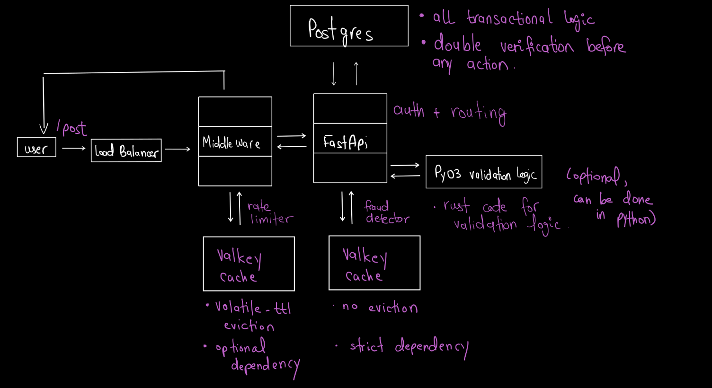

# Transactions/Actions/Loan Payments etc (Post Requests in General)

## Design Diagram:

### Load Balancer:
- Forwards Requests to FastAPI APIs

### Middleware :
- FastAPI middleware (every API has it's own.)
- Middleware checks if the IP exists, then increments the counter for the request sender if it does not exist, or adds it into the shared cache. 

### Valkey Caches:
#### Optional Dependency Volatile TTL-Cache
- For rate limiter.
- Backend should be live without it.

#### Strict Dependency No Eviction Cache:
- For Compliance Checks
- Backend must not be live without it.
- Some services maybe can, but other services, like payment processors, that absolutely need it, must respond with 404.
(Currently not implemented in my code.)

### PyO3 with Rust for logic:
- For high speed checks and concurrency.

### PostgreSQL
- PostgreSQL (most of the app logic lives within PostgreSQL, auth, role assignment, transactions etc.
